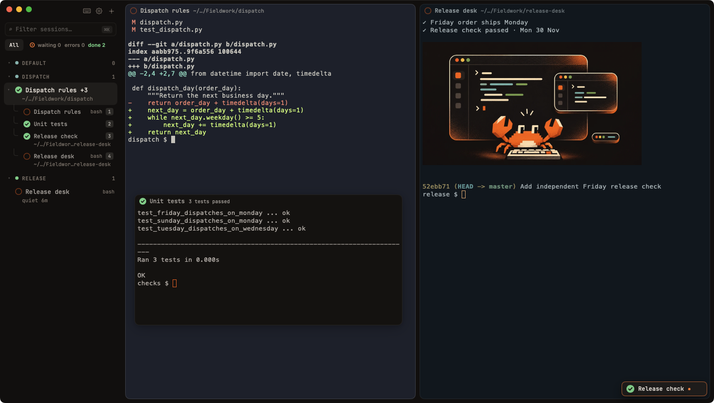

# Tako 🐙

A native macOS terminal with a permanent session sidebar and a canvas for tiled and floating panes. Its Rust engine and Metal renderer live in [tako-core](https://github.com/alex09x/tako-core), also available there as the TakoCoreUI Swift SDK for macOS and iOS.

[](https://apple.com/macos)
[](https://apple.com/ios)
[](https://rust-lang.org)
[](https://developer.apple.com/metal/)
[](LICENSE)

**[Download Tako 0.2.1 for macOS](https://github.com/alex09x/tako/releases/download/v0.2.1/Tako-0.2.1.dmg)** · [Release notes](https://github.com/alex09x/tako/releases/tag/v0.2.1)



---

## Highlights

- **Pure-Rust Engine (`tako_core`)**:
  - Full VT100, xterm, and modern terminal sequence support.
  - Kitty Keyboard Protocol (progressive enhancements, disambiguation, event queries).
  - Kitty Graphics Protocol images: RGB, RGBA and PNG over direct transmission, including
    query replies and placement sizing; `kitten icat` can detect and use this support.
    File and shared-memory transfers are not supported.
  - Asynchronous PTY execution with non-blocking multi-threaded pipeline.
  - Embedded SSH client support (`features = ["ssh"]`).
  - Shell command records from OSC 133 marks: each search hit says which command printed
    it, with its command line, working directory, exit code and start time. Only rows a
    single command wrote are attributed; a row holding a prompt and output, or two
    commands' output, belongs to none. A finished command without an exit code is not
    reported as a success.

- **Hardware-Accelerated Metal Renderer (`TakoCoreUI`)**:
  - GPU rendering with Metal vertex and fragment shaders (`TerminalShaders.metal`).
  - Sub-cell smooth scrolling at 60/120 Hz synchronized with `CADisplayLink`.
  - Row-level damage tracking (`memcmp` over packed cells), so an idle or
    mostly static screen does no redundant GPU work.
  - CoreText font shaping with fallback to system fonts and Nerd Font symbols.

- **Getting back to work**:
  - Each tab's screen and scrollback come back after a relaunch, marked with when they were saved;
    the new shell is never presented as the old one.
  - Find in All Tabs (<kbd>Cmd</kbd> + <kbd>Shift</kbd> + <kbd>F</kbd>) searches every open
    terminal's history and jumps to the match. Where the shell marks its commands (shell
    integration), matches are grouped under the command that printed them, with the exit status
    and directory the shell reported, and the start time Tako recorded.
  - A long command that finishes or fails while you are elsewhere marks its tab and can send a
    notification.
  - Experimental: `session-persistence = true` keeps each shell running across a quit and
    reattaches it on the next launch (not the Quick Terminal). Output from before the relaunch is
    searchable but not grouped by command.

- **Native macOS Experience**:
  - Permanent session sidebar and floating terminal panes with drag, resize, maximize and a minimize shelf.
  - Quick Terminal dropdown.
  - Scriptable from the command line: `takoctl` drives tabs, splits, input and output over a local socket.
  - Window transparency and customizable titlebar styling.

- **Cross-Platform Swift Component**:
  - Shared view layer: `TakoTerminalNSView` for macOS (AppKit) and `TakoTerminalView` for iOS (UIKit).

---

## Desktop Navigation

The left sidebar lists workspaces and sessions and stays open. Its search button opens the session filter; Escape clears and closes the filter. <kbd>Cmd</kbd> + <kbd>T</kbd> creates a session. Inside a session, <kbd>Cmd</kbd> + <kbd>D</kbd> or <kbd>Cmd</kbd> + <kbd>Shift</kbd> + <kbd>D</kbd> splits the current terminal: the new one joins the session grid beside it (right or below). To take a terminal out of the grid, use **Float Terminal**, a button in its header and an item of the header's right-click menu; a floating terminal moves freely above the grid (drag its header to move it, its edges or corners to resize it), and **Return to Grid** puts it back.

**Move to Tab** moves terminals into another tab of the same workspace, their processes still running. For one terminal it is a button in the terminal's header, an item of the header's right-click menu, and **Move Terminal to Tab** in the sidebar's context menu for that terminal; while the terminal shares its tab with others, the same menu also offers **New Tab**, which takes it out of the split into a tab of its own. On a session in the sidebar, **Move to Tab** moves the whole session: every terminal of it joins the other tab, and the emptied tab closes.

Each pane has minimize, maximize/restore and close controls. Minimized panes collect as capsules at the lower right, keep their processes running and continue showing status. Click a capsule to restore its position and keyboard focus. Maximizing fills the right workspace; double-clicking the pane header also toggles maximize/restore. Transitions respect macOS Reduce Motion.

<kbd>Cmd</kbd> + <kbd>W</kbd> closes the focused pane, <kbd>Cmd</kbd> + <kbd>Option</kbd> + <kbd>W</kbd> closes the session, and <kbd>Cmd</kbd> + <kbd>Shift</kbd> + <kbd>W</kbd> closes its window group. Closing the last pane leaves a **New Terminal** action in the workspace. Pane placement and presentation state return with restored sessions. `session-persistence = true` keeps the shell processes alive across an application quit.

## Quick Start: Building the macOS App

### Prerequisites

- macOS 14.0 or later on Apple Silicon
- [Rust toolchain](https://rustup.rs) (`rustup default stable`)
- Xcode 15+ and Command Line Tools (`xcode-select --install`)
- Python 3.10+

### Build & Run

```bash
# 1. Clone the repository
git clone https://github.com/alex09x/tako.git
cd tako

# 2. Build a development app with its own identity
TAKO_APP_DIR=target/macapp-dev \
TAKO_BUNDLE_ID=com.tako-core.terminal.dev \
python3 scripts/build-macapp.py

# 3. Launch it with a separate configuration and session home
mkdir -p target/dev-profile
touch target/dev-profile/config
open -n \
  --env "TAKO_CONFIG_PATH=$PWD/target/dev-profile/config" \
  --env "TAKO_SESSIONS_HOME=$PWD/target/dev-profile/sessions" \
  target/macapp-dev/Tako.app
```

For everyday installation, use the signed, notarized stable release linked above. The
development commands launch their own bundle and state without replacing
the installed application. Build, test, release and diagnostics entry points
are listed in [scripts/README.md](scripts/README.md).
From outside its panes, target this development instance with
`takoctl --bundle-id com.tako-core.terminal.dev ...`.

---

## Automated Self-Tests

Run the checks affected by a change on your configured test Mac:

```bash
./scripts/check.sh rust:search
./scripts/check.sh 'swift:ThemePresetStoreTests|ThemeWeightDiagnosticTests'
./scripts/check.sh e2e:theme-typography
./scripts/uitest.sh TakoFontWeightUITests
```

`TAKO_MAC` selects the test host. `scripts/ci.sh` is the explicit full
multi-stage release gate; it is separate from these targeted checks.

GitHub Mac CI and candidate/signing workflows are documented in
[CI and release delivery](docs/ci-and-releases.md).

Tako ships with an end-to-end integration test runner that exercises real macOS events, PTY streams, and Metal presentation callbacks:

```bash
# Run the macOS app self-test suite
./scripts/selftest-macapp.sh
```

```text
== keys: an NSEvent must produce the bytes it stands for ==
a          chars=a -> 61 (a)
shift+a    chars=A -> 41 (A)
ctrl+c     chars=  -> 03 ( )
ctrl+c cyr chars=с -> 03 ( )

== input: typing must reach the real shell and come back on screen ==
expected the last line to contain: hello world (space test)
╰ ❯ hello world

== scroll: a precise delta must move the grid by a fraction of a row ==
ok    after 1 of 3 points up             presented=0.3333 expected=0.3333
ok    after 2 of 3 points up             presented=0.6667 expected=0.6667
ok    after 3 of 3 points up             presented=1.0000 expected=1.0000

frames submitted=12 presented=10
macapp self-test: ok
```

The engine, TakoCoreUI and the session runtime are released by
[tako-core](https://github.com/alex09x/tako-core) and tested there. Tako
builds against one exact release of each: `swift/Package.swift` pins the
package (`swift/Package.resolved` records its commit), and
`packaging/session-runtime.json` pins the session runtime by hash.

To run the Swift suites (SwiftPM fetches the pinned tako-core release):
```bash
./scripts/swift-test.sh
```

`takoctl` builds, tests, lint and coverage use the latest stable [Mitts](https://mittsbuild.com/).
Install it with `curl -fsSL https://mittsbuild.com/install.sh | MITTS_INSTALL_ROOT="$HOME/.local" sh` and add
`~/.local/bin` to `PATH`. Unsupported commands or options stop the affected
check and are reported to Mitts; build scripts do not fall back to Cargo.

---

## Configuration

On first launch, Tako offers a setup guide for appearance, `takoctl`, agent
connections and optional notifications. Skip any step and return through
**Tako → Set Up Tako…** or **Settings → Setup…**. See the [setup guide](docs/setup.md).

Tako reads its configuration from `~/.config/tako/config`. 

Press <kbd>Cmd</kbd> + <kbd>,</kbd> inside Tako to open the in-terminal settings dialog. **Themes** lists complete presets. A single click or keyboard selection applies the preset immediately to open terminals; no Save or Return is needed. Opening or filtering the list does not change the current theme.

Tako ships its own complete theme presets: **TakoCore**, **Tako Forest**, **Tako Night**, **Tako Ocean**, and **Tako Slate**. Each preset owns its colors, ANSI palette, font family and size. Selecting a complete preset replaces appearance overrides at that level; other pane/workspace overrides and unrelated settings are retained. Customize a preset through **Edit theme**, rather than separate global font or color sections.

In **Themes**, choose **New Theme** or **Edit / Copy**. Built-ins open as a copy; your own presets can be edited in place. The theme's editor contains **Colors** (terminal, status and all 16 ANSI colors), **Fonts**, **Font Size**, **Layout**, and **Config** for its complete appearance configuration. Valid edits preview immediately without saving. **Cancel** restores the previous display; **Save** keeps the named theme and selects it. Invalid names, concurrent file edits and failed writes preserve the prior preset.

User presets live in the `themes/` directory beside the active config (`~/.config/tako/themes/` by default). They use `key = value` text with a `# tako-preset-version: 1` header. Legacy color-only theme files remain supported; their font inheritance is preserved.

### Workspace and terminal styles

Right-click a workspace heading in the Sessions sidebar and choose **Workspace Appearance…**. Right-click a terminal or split row and choose **Terminal Appearance…** or **Pane Appearance…** to choose its preset. These catalogs show themes only; editing a theme keeps all of its visual parameters together. Editing an inherited style creates a custom theme from its current effective appearance. **Inherit** clears the local appearance and follows its parent again. <kbd>Cmd</kbd> + <kbd>,</kbd> continues to choose Tako's global theme.

The style hierarchy is **global defaults → workspace preset → terminal pane preset**. Choose a complete preset at each level, or **Inherit** to follow the parent for the whole appearance. Colors, fonts, size and layout are edited inside the chosen theme. Choosing a preset clears earlier field overrides at that level; older configuration files with partial overrides remain supported.

Moving a terminal keeps its explicit pane preset and carries the source workspace's custom appearance with panes that inherited it. A session from an unstyled workspace still follows its destination. Choose **Inherit** after moving if you want to adopt the destination's appearance. Scoped styles are saved separately from window layouts, survive app restarts and session restoration, and apply without restarting the shell.

### Theme configuration from the CLI

`takoctl theme` uses the same preset format and validation as the editor. All supported visual keys are discoverable, including typography, metrics, padding, shaders, status colors and palette entries 0–255:

```sh
takoctl theme list
takoctl theme fonts
takoctl theme keys
takoctl theme create "Work" --from "Tako Night"
takoctl theme set "Work" font-family=Monaco font-size=18 'background=#121826' 'palette:1=#ff5577'
takoctl theme set "Work" font-feature=+liga font-feature=-dlig
takoctl theme show "Work" > work-theme.conf
takoctl theme create "Imported" --file work-theme.conf
cat work-theme.conf | takoctl theme create "Piped" --stdin
```

Font weight is numeric: `font-weight=550`, `font-weight-bold=700`, `font-weight-italic=450` and `font-weight-bold-italic=650`. Values are integers from 100 to 900. A variable font uses its `wght` axis, clamped to that font's own range; a static font selects the closest available face. Omitting the keys preserves the font's normal named-style behavior. The theme editor has the same controls inside **Fonts**, with 50-unit arrow steps; Config and CLI accept any integer.

Tako bundles JetBrains Mono Nerd Font and Fira Code 6.2 variable, with their SIL OFL licenses. Other installed monospaced families are discovered automatically. `takoctl theme fonts --json` includes each family's styles and real variable-weight range. Commercial fonts must be installed separately. For example:

```sh
takoctl theme create "Ocean Medium" --from "Tako Ocean"
takoctl theme set "Ocean Medium" 'font-family=Fira Code' font-size=16 font-weight=550 font-weight-bold=700
takoctl theme apply "Ocean Medium" --workspace "Legal"
```

Use `theme set NAME --file FILE` or `--stdin` to replace the full configuration, and `theme unset NAME KEY...` to reset selected settings. Repeated `font-feature` and `custom-shader` assignments replace their lists together. Paths inside a preset are relative to its theme directory; absolute shader paths work too. Files/stdin are read by the client, which sends configuration text to the app.

Assignments apply immediately and need an explicit mutation target:

```sh
takoctl theme apply "Work" --global
takoctl theme apply "Work" --workspace "Legal"
takoctl theme apply "Work" --session SESSION_UUID
takoctl theme current --target SESSION_UUID --json
takoctl theme current --workspace "Legal"
takoctl theme rename "Work" "Work v2"
takoctl theme reset --session SESSION_UUID
takoctl theme reset --workspace "Legal"
takoctl theme reset --global
takoctl theme delete "Work v2"
```

`--target`/`--pane`/`--session` identify a terminal pane; `self` and `active` work for live panes. A saved session's full UUID can be configured before reattaching it. `current` reports the selected preset, overrides and full effective configuration; JSON also includes the rendered configuration for a live pane. Read-only `current` defaults to the current pane. Named preset edits affect every scope using that preset; copy it first for an independent style.

Built-ins are read-only templates. Rename updates global, workspace and session references without changing the preset's contents. Delete refuses presets still assigned in the current profile, listing those scopes; reset or reassign them first. Removed files are kept in a hidden recovery directory and the JSON response returns `recovery_path`; restore with `theme create NAME --file PATH`. Failed rename writes keep both theme files recoverable rather than leaving references to missing files. Add `--json` to any command for structured output.

A local font size belongs to its pane or workspace and is not copied into a newly created pane. Ordinary transient zoom still follows `window-inherit-font-size` when the source has no scoped size override. Styles for missing/closed scopes are retained for undo and recovery; they are not pruned based on an incomplete window layout.

### Example `~/.config/tako/config`

```ini
# Theme & Appearance
theme = TakoCore
font-family = JetBrains Mono
font-size = 13.5
background-opacity = 0.95
background-blur-radius = 20

# Window layout
window-padding-x = 8
window-padding-y = 8
macos-titlebar-style = transparent

# Getting back to work: restore screen and scrollback after a relaunch,
# keeping at most 64 MB for all tabs together
window-save-content = true
window-save-content-limit = 64
# When a command of 10 s or more ends while its tab is not focused, mark the tab,
# ring the bell and send a system notification (never, unfocused or always)
notify-on-command-finish = unfocused
notify-on-command-finish-after = 10s
notify-on-command-finish-action = bell,notify
# A tab shows "working" only for jobs that finish on their own: ssh, vim,
# htop, tail -f and dev servers stay quiet. Add your own programs to either side
quiet-commands = my-repl, my-server
busy-commands = ssh
# Experimental: keep shells running across a quit and reattach them
session-persistence = false

# Keybindings
keybind = super+t=new_tab
keybind = super+d=new_split:right
keybind = super+shift+d=new_split:down
keybind = super+w=close_surface
```

---

## Swift Package Integration

Tako's terminal view can be embedded in any macOS or iOS application: add
[tako-core](https://github.com/alex09x/tako-core) as a Swift Package and link
its `TakoCoreUI` product.

```swift
import TakoCoreUI

// Create terminal surface
let terminal = TakoTerminalNSView(frame: view.bounds)
terminal.delegate = self
view.addSubview(terminal)

// Send data received from PTY or SSH
terminal.feed(data: incomingBytes)
```

Implement `TakoTerminalNSViewDelegate` to forward user input and resize events back to your backend transport.

Runnable samples for macOS, iOS and the C ABI, what the host is responsible for, limits and
compatibility, and the versioning policy: [tako-core's docs/takocore.md](https://github.com/alex09x/tako-core/blob/main/docs/takocore.md).

---

## Architecture

For an in-depth breakdown of the internal layers, UniFFI bridging, PTY pipeline, and GPU rendering architecture, see [ARCHITECTURE.md](ARCHITECTURE.md).

---

## License & Attribution

Tako is licensed under the [MIT License](LICENSE).

- The bundled JetBrains Mono Nerd Font and Fira Code are under the SIL Open Font License 1.1 ([JetBrains license](swift/Resources/fonts/OFL.txt), [Fira Code license](swift/Resources/fonts/FiraCode-OFL.txt)).
- Reference test fixtures adapted from [Alacritty](https://github.com/alacritty/alacritty) (Apache 2.0 License, © The Alacritty Project).
- Full third-party notices and licenses are documented in [NOTICE.md](NOTICE.md).

---

## Citation

If you use Tako in your research or project, please cite the software archive using the metadata below or via [CITATION.cff](CITATION.cff):

```bibtex
@software{panasenko_2026_23028534,
  author       = {Panasenko, Alexander},
  title        = {Tako: GPU-accelerated terminal for macOS and iOS},
  month        = sep,
  year         = 2026,
  publisher    = {Zenodo},
  version      = {0.1.2},
  doi          = {10.5281/zenodo.23028534},
  url          = {https://zenodo.org/records/23028534}
}
```
